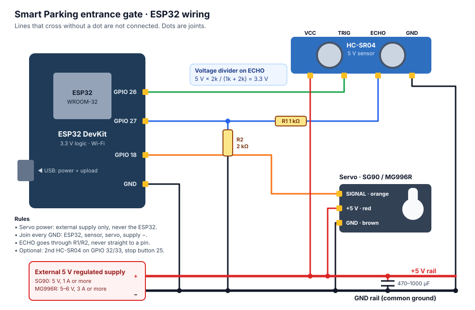

# Smart Parking: automatic entrance gate (ESP32 + HC-SR04 + servo)

The ESP32 measures the distance to an approaching vehicle with an HC-SR04, lifts a servo-driven barrier,
and reports everything live to the **Entrance Gate** page of the Smart Staff website.

```
 HC-SR04 ──► ESP32 ──HTTPS──► Firebase Realtime Database ◄──live── website (Entrance Gate page)
 servo  ◄──        ◄─commands─        /gate/command        ◄─buttons─ manager account only
```

The website is hosted on GitHub Pages, so the ESP32 cannot be reached from it directly, and it must
not be opened to the internet. Both sides talk to Firebase instead, over HTTPS:

- The ESP32 signs in with **its own Firebase account** and writes its status to `/gate/state` about every
  0.25–2 s.
- The website writes button presses to `/gate/command`. The ESP32 checks for new commands every 0.4 s.
- The **database rules** (`firebase/database.rules.json`) allow only the ESP32's account to write the
  status, and only the **verified manager email** to send commands. Anyone signed in can watch.
- The ESP32 checks Firebase's certificate (`root_ca.h`), so the password and commands can't be read or
  faked on the Wi-Fi network.
- Commands older than 15 s are ignored, and so is a command left from before the ESP32 restarted.

## 1. Parts

| Part | Notes |
| --- | --- |
| ESP32 DevKit (WROOM-32) | 30 or 38 pin, any brand |
| HC-SR04 | 5 V ultrasonic sensor |
| Servo: SG90 or MG996R | SG90 for a small model, MG996R for a heavier arm |
| Resistors: 1 kΩ and 2 kΩ | Voltage divider for ECHO (or 10 kΩ + 20 kΩ, or a level shifter) |
| External 5 V regulated supply | SG90: 5 V, at least 1 A. MG996R: 5–6 V, at least 3 A |
| Capacitor 470–1000 µF, 10 V or more | Across the servo supply, close to the servo |
| Optional: a second HC-SR04 + 1 kΩ/2 kΩ | "Clearance sensor" after the barrier, so the gate can close by itself |
| Optional: push button | Local emergency stop |

## 2. Wiring



| From | To | Note |
| --- | --- | --- |
| HC-SR04 **VCC** | +5 V rail (external supply +) | The sensor needs 5 V |
| HC-SR04 **GND** | GND rail | |
| HC-SR04 **TRIG** | ESP32 **GPIO 26** | 3.3 V is enough to trigger it |
| HC-SR04 **ECHO** | **1 kΩ** → ESP32 **GPIO 27**, and from GPIO 27 **2 kΩ** → GND | Brings 5 V down to 3.3 V |
| Servo **signal** (orange/yellow) | ESP32 **GPIO 18** | |
| Servo **+** (red) | +5 V rail (external supply +) | Never from the ESP32 |
| Servo **−** (brown/black) | GND rail | |
| ESP32 **GND** | GND rail | **Common ground**: required |
| Capacitor | + leg to +5 V rail, − leg to GND rail | Stops the ESP32 resetting when the servo starts |
| ESP32 | USB from your PC | Power and upload |
| *Optional* clearance HC-SR04 | TRIG → GPIO 32, ECHO → 1 kΩ/2 kΩ → GPIO 33 | Set `CLEAR_SENSOR_ENABLED 1` |
| *Optional* stop button | GPIO 25 → button → GND | Set `ESTOP_BUTTON_ENABLED 1` |

**Important:**

- **ECHO is a 5 V signal and the ESP32 is 3.3 V.** Never connect ECHO straight to a GPIO. Use the divider
  (5 V × 2k / (1k + 2k) = 3.33 V) or a level shifter.
- **Do not power the servo from the ESP32** (not the 3V3 pin, not VIN while on USB, never a GPIO). A servo
  pulls 0.5–2.5 A when it moves.
- **Join all grounds**: ESP32 GND, sensor GND, servo GND and the supply's −.
- To run without USB later, feed the ESP32's **VIN** pin from the same 5 V rail, but unplug USB first.
- The pins chosen are plain GPIOs (not boot-strapping or input-only pins). If your board is different,
  change them in `config.h`.

## 3. Firebase setup (once, about 10 minutes)

**Already done for this project on 12 Nov 2026:** the database exists in Belgium (europe-west1), `data.js` has its URL, the ESP32 account `gate-esp32@smart-staff.iot` exists, and the rules are published. Skip to section 4.

Use the Firebase console for the project **smart-staff-2de6a**: https://console.firebase.google.com

1. **Create the Realtime Database.** Build → Realtime Database → *Create database*. Pick a location
   (Belgium `europe-west1` is closest to Egypt) and *Start in locked mode*. Copy the URL shown at the top
   of the *Data* tab, for example `https://smart-staff-2de6a-default-rtdb.europe-west1.firebasedatabase.app`.
2. **Tell the website.** In `data.js`, set `gate.databaseURL` to that URL (no trailing slash).
3. **Create the ESP32's account.** Build → Authentication → Users → *Add user*. Use an email that is only
   for the gate (for example `gate-esp32@smart-staff.iot`) and a long random password. Copy the new
   user's **User UID**.
4. **Publish the rules.** Realtime Database → *Rules*. Paste the contents of `firebase/database.rules.json`
   and click *Publish*. The file already holds the UID of `gate-esp32@smart-staff.iot`; if you create a
   different ESP32 account, put its UID there instead. These rules only cover the Realtime Database.
   Your Firestore rules stay as they are.
5. **Manager email.** Commands are accepted only from `23p0317@eng.asu.edu.eg`, and only once that email is
   confirmed, which the site already asks for. To change the manager, edit the email in the rules and in
   `data.js` (`auth.managerEmails`).

## 4. Upload the firmware with Arduino IDE

1. Install **Arduino IDE 2**. In *Boards Manager*, install **esp32 by Espressif Systems** (2.x or 3.x;
   tested with 3.3.12). No other libraries are needed.
2. Open `esp32/smart_gate/smart_gate.ino`. The other files in that folder open as tabs.
3. Copy `secrets.example.h` to **`secrets.h`** in the same folder. You can leave the Wi-Fi and
   password lines as they are and set them after the upload instead (section 5, *Setting the Wi-Fi*).
   Or fill in: your Wi-Fi name and password (2.4 GHz), the ESP32 account's password, and an **update
   password** (`OTA_PASSWORD`, 8+ characters) for uploads over Wi-Fi later.
   `secrets.h` is in `.gitignore`, so it never goes to GitHub.
4. *Tools → Board → esp32 → ESP32 Dev Module*. Keep *Tools → Partition Scheme* on the default
   (*Default 4MB with spiffs*): Wi-Fi uploads need it. *Tools → Port*: the COM port that appears when the
   ESP32 is plugged in. If none appears, install the USB driver for your board's chip (CP210x or CH340).
5. Click **Upload**. If it stops at `Connecting....`, hold the board's **BOOT** button until it starts.
   **The first upload must be by USB cable.** After that you can upload over Wi-Fi (section 5).
6. Open *Tools → Serial Monitor* at **115200** baud. You should see:

   ```
   Smart Parking entrance gate, firmware 1.3.0
   [servo] signal on GPIO 18: running (50 Hz)
   [gate] Gate closed
   [setup] saved Wi-Fi: MyWiFi
   [wifi] connected, IP 192.168.1.23, signal -58 dBm
   [ota] Wi-Fi updates on: network port "smart-gate" (only while the gate is closed)
   [web] status page: http://smart-gate.local  or  http://192.168.1.23
   [firebase] signed in as gate-esp32@smart-staff.iot (uid ...)
   ```

The on-board LED blinks slowly while connecting, stays on when it is online, blinks fast during an
emergency stop, and flickers very fast while new firmware arrives over Wi-Fi.

## 5. Laptop and ESP32 on the same Wi-Fi

**Setting the Wi-Fi** (no need to edit `secrets.h`). Choose either way:

- **Over the USB cable (easiest):** with the ESP32 plugged in, run this in PowerShell in the `esp32` folder:
  `powershell -ExecutionPolicy Bypass -File .\setup-wifi.ps1`.
  It lists the networks your laptop can see. Type the **number** of the gate's network, then the Wi-Fi
  password, the ESP32 account password and an optional update password. These are typed hidden and go
  straight to the ESP32. It ends with *"Done: the gate is online"*. If it says the ESP32 restarts *"as soon
  as the gate is closed"*, unplug and replug the USB to apply the settings now.
- **From the ESP32's own Wi-Fi:** while it has no working Wi-Fi, the ESP32 opens **SmartGate-Setup**
  (password `smartgate`, set in `config.h`). Join it from a laptop or phone, and a setup page opens
  (or go to http://192.168.4.1). Pick your network, fill in the passwords and save. Your laptop has no
  internet while it is joined to SmartGate-Setup.

Settings saved either way are kept in the ESP32 through restarts and new uploads, and they take
priority over `secrets.h`. To start over, use *Forget the saved Wi-Fi and passwords* on the setup page.

**No router?** Use the laptop's hotspot: Windows *Settings → Network & internet → Mobile hotspot*.
Under *Edit* (or *Properties*), set **Network band: 2.4 GHz**. Note the hotspot's name and password, put
them in `secrets.h` as `WIFI_SSID` / `WIFI_PASSWORD`, and switch the hotspot on. The ESP32 then joins
the laptop and reaches Firebase through the laptop's internet.

**Status page.** On the laptop, open **http://smart-gate.local** (or the IP address from the Serial
Monitor). It shows the gate, angle, mode, distance, emergency stop, Wi-Fi signal and whether the website
link is online, straight from the ESP32, refreshing every second. It works without internet, which helps
when checking the wiring. It is **view only**: nothing on the local network can open the gate. Control
stays with the manager account on the website.

**Uploading over Wi-Fi** (after the first USB upload, with `OTA_PASSWORD` set):

- **Arduino IDE:** *Tools → Port* lists a network port **smart-gate at 192.168.x.x**. Pick it, click
  Upload, and type the update password when asked.
- **Script:** in PowerShell, in the `esp32` folder, run `.\upload-wifi.ps1`
  (or `.\upload-wifi.ps1 192.168.x.x` if `smart-gate.local` isn't found). It compiles and uploads, reading
  the password from `secrets.h`.
- The first time, Windows Firewall may ask about **espota**. Allow it, or the upload can't finish.
- For safety, the ESP32 only accepts an update while the **gate is closed**, nothing is in front of the
  sensor, and the emergency stop is off. During the update the barrier stays down. The website shows
  ESP32 OFFLINE for about 20–30 seconds while it restarts.

## 6. Connect it to the website

Once `data.js` has the database URL and the ESP32 prints `signed in`, open the site's **Entrance Gate**
page. The badge changes to **LIVE · ESP32** and the status, distance and barrier update in real time.
If the ESP32 stops reporting for 6 seconds, the page shows **ESP32 OFFLINE** with a gray light.

Only the manager account can press the buttons. Everyone else sees the gate in view-only mode. While the
ESP32 is offline, *Start simulation* runs the same gate logic in the browser. The page is then clearly
labelled **SIMULATION MODE**, and nothing is sent to the hardware.

## 7. How the gate behaves

| Situation | What happens |
| --- | --- |
| Vehicle within 15 cm for 3 readings in a row (AUTOMATIC) | Barrier opens smoothly, 0° → 90° in about 1.4 s |
| Vehicle still there | Barrier stays open |
| One HC-SR04 only (default) | **Never closes by itself.** The manager presses CLOSE GATE, then confirms that the lane is clear |
| With the clearance sensor | Closes by itself once that sensor has seen the vehicle pass and the lane has been clear for 2 s |
| CLOSE pressed while a vehicle is detected | Refused, and the website shows "Refused: a vehicle is at the gate" |
| Something detected while the barrier is closing | It goes back up |
| HC-SR04 stops answering | Shown as *Sensor fault*. The gate will not close until it works again |
| EMERGENCY STOP (website or button) | Barrier freezes where it is and ignores everything until RELEASE EMERGENCY STOP |
| MANUAL mode | No automatic opening. Only the website buttons move the barrier |
| Wi-Fi lost | The gate keeps working locally. The ESP32 reconnects by itself |

## 8. Settings (`config.h`)

| Setting | Default | Meaning |
| --- | --- | --- |
| `DETECT_CM` | 15 | Detection distance |
| `RELEASE_HYSTERESIS_CM` | 5 | A vehicle must move past 20 cm before it counts as gone |
| `DETECT_CONFIRM` / `RELEASE_CONFIRM` | 3 / 5 | Readings in a row, to filter noise |
| `SERVO_CLOSED_DEG` / `SERVO_OPEN_DEG` | 0 / 90 | Barrier angles. Swap them if your servo is mounted the other way |
| `SERVO_STEP_MS` | 15 | ms per degree. Bigger is slower and smoother |
| `SERVO_MIN_US` / `SERVO_MAX_US` | 500 / 2500 | Pulse range. Narrow it to 1000/2000 if the servo buzzes at the ends |
| `CLEAR_SENSOR_ENABLED` | 0 | 1 when the second HC-SR04 is wired |
| `CLEAR_DETECT_CM` / `CLEAR_HOLD_MS` | 20 / 2000 | Clearance sensor range and how long the lane must stay clear |
| `ESTOP_BUTTON_ENABLED` | 0 | 1 when the stop button is wired |
| `CMD_POLL_MS` / `HEARTBEAT_MS` | 400 / 2000 | How often it checks for commands, and its minimum reporting rate |
| `DEVICE_HOSTNAME` | smart-gate | Name on the local network (`smart-gate.local`) |
| `STATUS_PAGE_ENABLED` / `OTA_ENABLED` | 1 / 1 | Local status page, and uploads over Wi-Fi |

If you change the detection distance or angles, also change `gate.sim` in `data.js` so the simulation
matches.

## 9. Testing checklist

Do these with the barrier arm free to move and nothing in its path.

1. **Sensor:** move your hand from 50 cm to 5 cm in front of the HC-SR04. The website's distance follows it.
2. **Automatic open:** at about 12 cm, Vehicle Detection turns DETECTED and the barrier rises.
   The light shows yellow while it moves, then green.
3. **Stays open:** keep your hand there, and the barrier stays up.
4. **Close refused:** with your hand still there, press CLOSE GATE twice. The page says it was refused.
5. **Manual close:** remove your hand, then press CLOSE GATE twice. The barrier lowers and the light turns red.
6. **Reversal:** press CLOSE and put your hand back while the barrier is coming down. It goes back up.
7. **Manual mode:** press ENABLE MANUAL MODE. Your hand no longer opens it, but OPEN GATE does.
8. **Emergency stop:** press OPEN, then EMERGENCY STOP halfway. The barrier freezes. Release it.
9. **Offline:** unplug the ESP32. Within 6 s the page shows ESP32 OFFLINE. Plug it back in and it returns.

## 10. Troubleshooting

| Problem | Fix |
| --- | --- |
| `sign-in failed (HTTP 400)` with `INVALID_LOGIN_CREDENTIALS` | Email or password in `secrets.h` doesn't match the account from step 3 |
| `status update failed (HTTP 401)` | The rules don't have this ESP32's UID, or they were not published |
| `HTTP 404` | Wrong `FIREBASE_DB_URL` (copy it from the console, no trailing slash) |
| Stuck on `connecting to …` | Wrong Wi-Fi details, or a 5 GHz-only network |
| Website stays OFFLINE but the serial log looks fine | `gate.databaseURL` in `data.js` is empty or different |
| Website buttons say "Not allowed" | You are not signed in as the manager, or the manager email isn't confirmed yet |
| Distance always "Out of range" | ECHO/TRIG swapped, the sensor has no 5 V, or the divider is wired wrong |
| ESP32 resets when the servo moves | Servo is on the ESP32's power. Use the external supply and the capacitor, and join the grounds |
| `smart-gate.local` doesn't open | Use the IP address from the Serial Monitor instead. The laptop and the ESP32 must be on the same Wi-Fi |
| No network port in Arduino IDE / Wi-Fi upload times out | Close the gate and clear the sensor first (updates are refused otherwise), check `OTA_PASSWORD` was uploaded by USB once, and allow espota in Windows Firewall |

## Safety

This is a **prototype for a scale model**. One HC-SR04 does not prove that a vehicle or person has
cleared the barrier, which is why the gate never closes by itself without the second sensor. Even with
it, a full-size motorised gate needs certified safety hardware: photocells, safety edges, force-limited
drives and a hard-wired emergency stop that cuts motor power.
